# PrimitiveQ: Simulated Quantum Closed\-Loop SNN

**NeuroMantle 0\.4\.6\.3** · deterministic spiking network and replayable software quantum routine

    

A deterministic spiking network with a C11 simulation core, weighted routing and 1024\-bit similarity input, backed by exact causal event records and seeded entropy\. Spikes can drive a five\-qubit stabilizer **simulation**, whose syndrome and correction feed current back to the network on the next tick\. An optional separate mode encodes synaptic\-weight bits in simulated five\-qubit codewords and checks restoration before a network step\. The command also exposes the supplied developer CLI, Vanta compiler and Surreal proof tools through separate, explicit entry points\.

The top\-level Apache\-2\.0 license covers NeuroMantle’s original code\. Each bundled companion keeps its own license in `vendor/`\.

For the sequence of validated changes and the evidence behind each stage, start with [Development path](docs/DEVELOPMENT_PATH.md)\. The [test matrix](docs/TEST_MATRIX.md) identifies executable checks for this snapshot; [evidence index](evidence/INDEX.md) separates current replay artifacts from earlier control and training evaluations\.

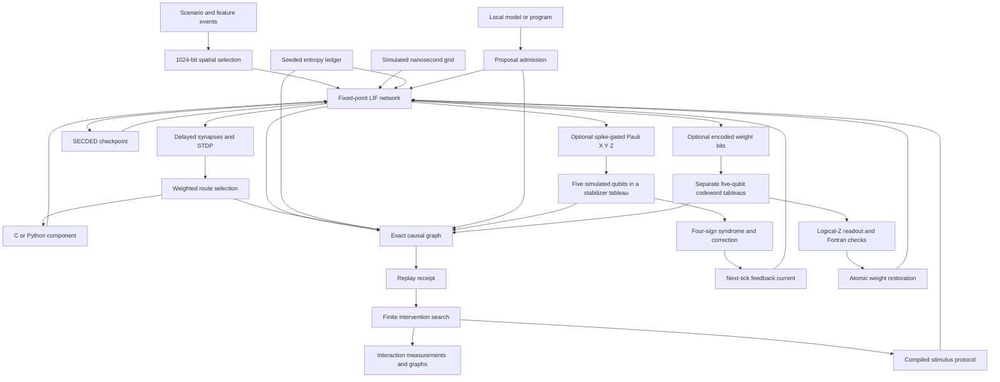

The two tableau branches have distinct roles\. The spike\-gated branch is a
software five\-qubit feedback experiment\. The encoded\-weight branch is an
optional software memory\-recovery mode\. Both are recorded in replay receipts;
neither connects to a physical quantum processor\.

The C hot path calculates every neuron transition, delayed delivery and plasticity update\. A single ordered scheduler makes simultaneous spikes deterministic\. Exact rational arithmetic checks candidate plasticity transitions in ten\-tick batches, and incremental SHA\-256 state roots, a causal graph and a seeded entropy ledger form the receipt path\. Routing and spatial search use the supplied NeuroRoute code\. A weighted route can invoke a bound C or Python executable and inject its computed current on the next tick\. Every tick records before/after roots, spike routing, module output, causal parent and entropy root\. A refusal also has a replayable receipt\.

## Build and use

Requires a C11 compiler, a C\+\+23 compiler, a Fortran 2008 compiler such as gfortran, Python 3 and Make\. On Linux x86\-64, the bundled Vanta and Surreal command tools can also run\.

Start with the [step\-by\-step guide](docs/GETTING_STARTED.md)\. The [C API reference](docs/C_API.md), [command and process ABI](docs/API_ABI.md), and [system interface map](docs/SYSTEM_INTERFACE.md) describe the public functions, executable contracts and operating system interactions\.

```sh
make -j2
make test
./bin/neuromantle run examples/two_neuron.nm run.receipt
./bin/neuromantle verify examples/two_neuron.nm run.receipt
./bin/neuromantle dev status
./bin/neuromantle compile-vanta vendor/vanta/examples/heterogeneous.vnt heterogeneous
./heterogeneous
./bin/neuromantle surreal qec-describe
./bin/neuromantle ai-run examples/two_neuron.nm examples/ai/local_policy.py ai.receipt
./bin/neuromantle ai-verify examples/two_neuron.nm ai.receipt
./bin/neuromantle ai-verify-live examples/two_neuron.nm ai.receipt
./bin/neuromantle run examples/ecc.nm ecc.receipt
./bin/neuromantle run examples/bio_clock.nm bio.receipt
./bin/neuromantle verify examples/bio_clock.nm bio.receipt
./bin/neuromantle compare examples/bio_clock.nm examples/bio_clock_variant.nm pair.receipt
./bin/neuromantle compare-verify examples/bio_clock.nm examples/bio_clock_variant.nm pair.receipt
```

`run` exits 0 for admission and 3 for a refused scenario, writing a receipt in either case\. `verify` independently reruns the scenario and checks the entire receipt byte for byte\. The input and its execution environment are trusted for replay; a receipt is a reproducibility and tamper detection record, not an unforgeable attestation or formal proof of an arbitrary module\.

Version 0\.4 adds an optional simulated nanosecond grid for membrane time constants, delays, refractory periods, STDP windows, stimuli and total duration\. Exact grid validation feeds the original integer transition engine; old scenarios and receipts retain their former format\. A paired intervention command runs two scenarios with identical model lines and different `stim` or `bio_stim` lines, commits both underlying receipts, and records the first divergent state root\. [Biological time semantics](docs/BIO_CLOCK.md) and [paired intervention protocol](docs/INTERVENTIONS.md) give the bounds and interpretation\. Neither feature changes the meaning of a tick in existing benchmarks\.

A local model can propose bounded stimuli through an executable adapter\. `ai-run` records its exact output and runs the proposed scenario through the ordinary admission engine\. `ai-verify` replays the recorded output without model inference; `ai-verify-live` also repeats inference and requires identical output\. The included executable policy demonstrates the protocol with real computed input\. [Protocol and model setup](docs/AI_PROTOCOL.md) and [API and ABI](docs/API_ABI.md) specify every public call and process frame\.

An optional software SECDED checkpoint corrects one flipped bit per encoded word and detects two\. A separate admission gate verifies a supplied five\-qubit QECC certificate with Surreal\. [ECC semantics and runnable example](docs/ECC.md) distinguish classical state protection from the quantum\-code proof\.

## 0\.4\.6\.3: bounded readout decoding and replayable OS seed

The active fault\-recovery path now sends the four\-bit syndrome and raw
logical\-Z observation to a compiled Fortran decoder\. Its unique Pauli lookup
recovers the logical bit under the stated one\-fault bound, checks a separate
snapshot of the intended synaptic weight bit, and agrees with the corrected
C tableau before any weight is committed\. Clean restorations retain their
existing path\. The new `seed-from-os` command materializes one Linux
`getrandom()` sample into a scenario; ordinary `run` and `verify` then replay
seeded Philox draws\. [Readout and entropy contract](docs/READOUT_ENTROPY.md)\.
Neither path connects to a physical quantum device\. A measured hardware
readout and device attestation are not claimed\.

## 0\.4\.6\.2: encoded synaptic memory

The ordinary SNN now has an optional `qmemory weights5` mode\. All configured
synaptic weights are encoded bit by bit as five\-qubit logical basis states in
a classical tableau simulator\. Declared single\-qubit Pauli faults are decoded
before the next network step; a compiled Fortran kernel reconstructs the signed
weights\. The certificate, canonical tableau root and correction enter the
ordinary receipt and independent replay\. The older SECDED memory checkpoint
remains a separate layer\. [Fault model and run commands](docs/ECC.md) state
precisely what is and is not protected\. Ada/SPARK and Common Lisp were evaluated
as future proof and symbolic tools; this release makes no untested proof or
performance claim for them\. [Measured Fortran kernel and other language](docs/QMEMORY_KERNEL.md)
[choices](docs/QMEMORY_KERNEL.md) include the measured canonical clean path,
an optional ISPC classifier experiment that was slower on this tableau layout,
and the raw comparison methods\. The active Fortran decoder is retained\.

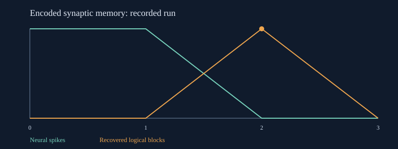

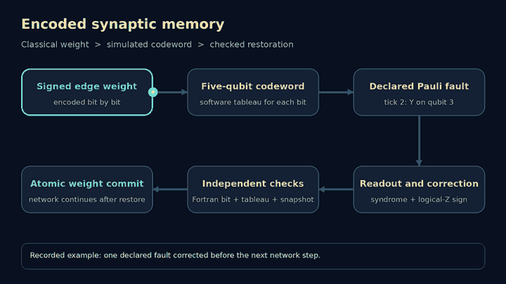

The animation follows the recorded fault at tick two in
[`examples/qmemory_weights.nm`](examples/qmemory_weights.nm) and its
[replayable receipt](evidence/qmemory/run.receipt)\. It illustrates the
declared software fault and correction path; the SVG above plots the
recorded network behavior\. The second panel of the animation locates the
five\-qubit codeword tableau for each encoded weight bit\.

## 0\.4\.6\.1: certified five\-qubit feedback

The five\-qubit &#91;&#91;5,1,3&#93;&#93; certificate now gates an optional **encoded** `|0_L>` world\. An SNN spike applies a single simulated physical\-qubit X, Y or Z Pauli fault; a `Q` rule reads four deterministic stabilizer eigenvalues, corrects one fault and sends next\-tick current to a configured neuron on nonzero syndrome\. The certificate bytes, proof and verifier executable digests, syndrome, correction and full tableau state enter the replay receipt\. This is a classical stabilizer simulation under a declared single\-fault bound, not physical quantum computation or protection of the SNN’s RAM\. [Full contract and limits](docs/PRIMITIVEQ_WORLD.md)\.

```sh
./bin/neuromantle world-run examples/coupled_five_code.nmw evidence/qecc_coupled/run.receipt evidence/qecc_coupled/dynamics.svg
./bin/neuromantle world-verify examples/coupled_five_code.nmw evidence/qecc_coupled/run.receipt evidence/qecc_coupled/dynamics.svg
```

The earlier two\-qubit coupled demonstration and receipts remain in `examples/coupled_world.nmw` and `evidence/coupled/`\.

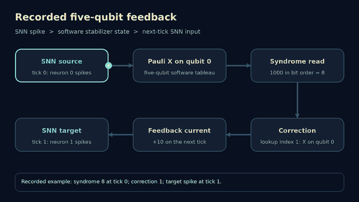

This animation follows the [three\-tick example](examples/coupled_five_code.nmw)
and its [verified receipt](evidence/qecc_coupled/run.receipt): neuron zero
spikes on tick zero, the simulated code reports syndrome eight and correction
one, and feedback drives neuron one on tick one\. The [recorded SVG](evidence/qecc_coupled/dynamics.svg)
[graph](evidence/qecc_coupled/dynamics.svg) shows the measured tick trace\. In
the dark animation, the Pauli operation acts on the five simulated qubits in
the tableau panel before the syndrome is read; feedback then returns to the
SNN on the next tick\.

## 0\.4\.6: coupled world and PrimitiveQ

The new `.nmw` scenario runs the existing fixed\-point SNN alongside a conservative integer field and a **classical simulation** of up to 16 stabilizer qubits\. Real network spikes gate field flux and Clifford operations; the field can inject sensor current into the SNN, and an actual stabilizer measurement can inject current on the next tick\. The whole transition is staged and refused atomically on invalid arithmetic or state\. The quantum state is an ordinary software tableau\. Earlier SNN scenarios and receipts retain their existing semantics\.

A bounded native search evaluates real coupled transitions on separate training and validation cases, then reports the unseen holdout results\. A three\-pulse experiment executes all eight combinations and measures exact one\-, two\- and three\-pulse finite differences on the target field and spike count\. Both issue replayable receipts and SVG graphs\. These results establish behavior for the declared finite scenario; they do not prove general self\-improvement, general intelligence or novel quantum hardware\. [Semantics, research, bounds and tests](docs/PRIMITIVEQ_WORLD.md) document the implemented claims\.

```sh
./bin/neuromantle world-run examples/coupled_world.nmw run.receipt dynamics.svg
./bin/neuromantle world-verify examples/coupled_world.nmw run.receipt dynamics.svg
./bin/neuromantle world-improve examples/coupled_world.nmw improve.receipt improve.svg
./bin/neuromantle world-improve-verify examples/coupled_world.nmw improve.receipt improve.svg
./bin/neuromantle world-interaction examples/coupled_world.nmw interaction.receipt interaction.svg
./bin/neuromantle world-interaction-verify examples/coupled_world.nmw interaction.receipt interaction.svg
python3 scripts/watchdog.py --timeout 600 --log build/check.log -- make test
```

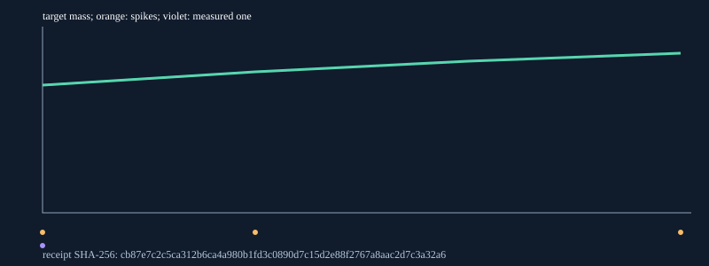
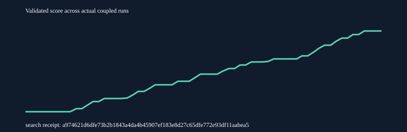
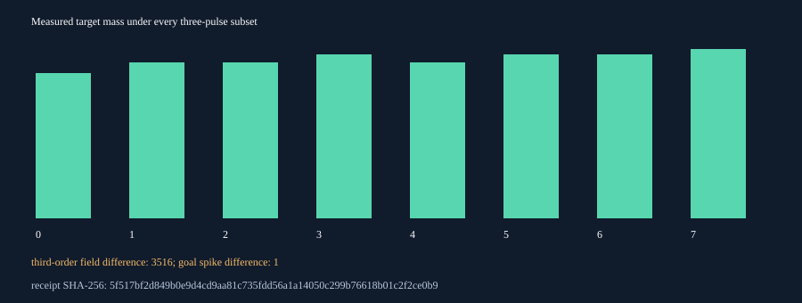
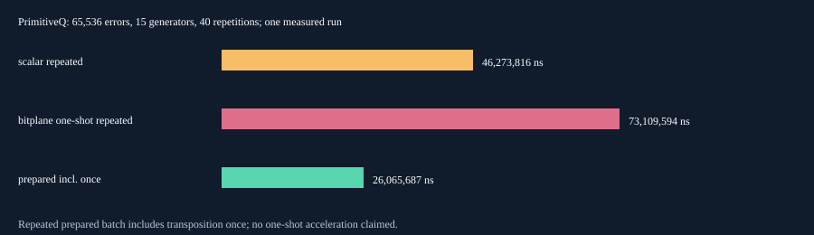

## Experiment engine and executable protocol synthesis

Version 0\.4\.1 executes a baseline, all declared single pulses and every unordered pulse pair\. It measures committed state and spike divergence, checks finite\-range goal monotonicity, computes exact two\-pulse interaction, and identifies the single\-pulse current/latency frontier\. The intervention compiler chooses the least\-current successful single or pair, emits a real runnable scenario and its receipt, and repeats the selected execution\. Both the complete search and all three generated SVGs can be independently replayed\. No binary\-search monotonicity assumption is needed\.

Run `python3 scripts/run_atlas_demo.py` to regenerate the measured example\. [Experiment protocol](docs/EXPERIMENT_ENGINE.md) explains all commands and bounds; [research notes](docs/RESEARCH_0_4_1.md) distinguishes the implementation from claims of scientific priority\.

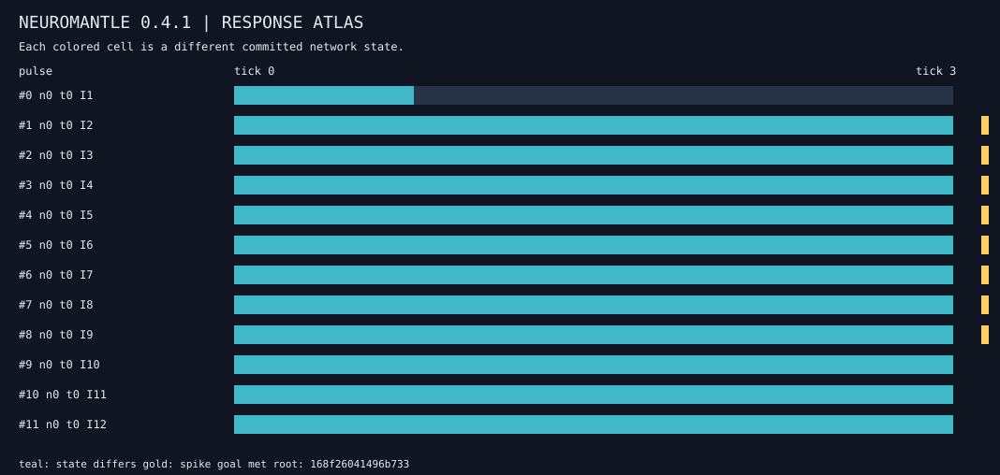
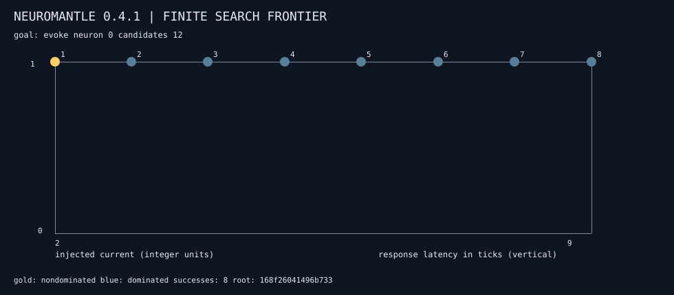
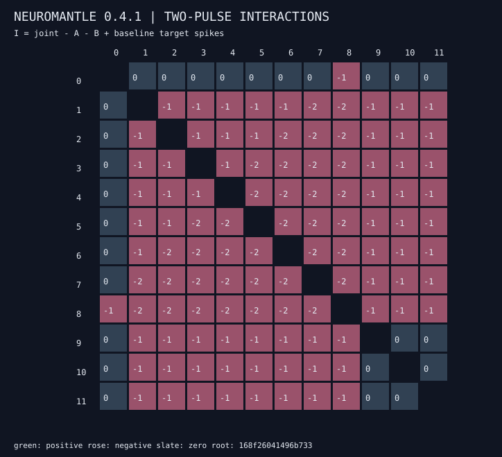

The six\-neuron delayed excitatory/inhibitory STDP example demonstrates a successful composed protocol when every single candidate fails\. Its [interaction graph](evidence/atlas/circuit/interaction.svg), [search receipt](evidence/atlas/circuit/response.receipt), [compiled scenario](evidence/atlas/circuit/selected.nm) and [network receipt](evidence/atlas/circuit/selected.receipt) are included\.

## Native parameter search and similarity prototypes

The standalone C optimizer searches bounded signed parameter vectors with a fixed evaluation order and integer objectives\. A separate 1,024\-bit prototype fitter and predictor use exact Hamming distance\. In the coupled\-world experiment the optimizer evaluates real network, field and tableau transitions on declared training and validation cases, and then reports separate holdout results\. This is bounded parameter improvement for a finite task, not a claim of open\-ended recursive self\-improvement\.

The [nightly workflow](.github/workflows/nightly.yml) runs every day at 03:17 UTC and on demand when this source is uploaded to a GitHub repository with Actions enabled\. It runs native and sanitizer gates, rebuilds the optimized binary, regenerates the examples, packages a manifest checked ZIP, validates the extracted archive and uploads the ZIP plus SHA\-256 as a workflow artifact\. This snapshot is the locally validated source and artifact; it is not an observed remote workflow run\.

## Process isolation and measured performance

Module, local adapter and QECC verifier children install a fail\-closed Linux seccomp policy before execution\. The policy denies filesystem mutation, socket creation and process creation\. `ai-run-socket` grants one explicitly connected local Unix stream to an adapter\. It does not hide files the caller can read; [sandbox details](docs/SANDBOX.md) describe the exact boundary and adversarial tests\.

In archived version 0\.3 measurements on a Xeon virtual machine, a 1,024\-neuron, four\-synapse\-per\-neuron workload reached 29,699 to 48,057 native core ticks/s\. Full CLI receipt generation reached 567 to 2,214 ticks/s, depending on spike density\. Including a separate receipt replay gave 286 to 1,107 verified tick operations/s &#40;vTOS&#41;\. These are separate measurements, not a promise for other hardware or a comparison with another simulator\. [Methods and raw timings](docs/BENCHMARKS.md) include all cases and repeat measurements\.

## Dynamics

Each configured neuron has membrane voltage, reset and threshold values, a Q16\.16 leak factor and a refractory duration\. Tick `t` computes `reset + trunc((voltage - reset) × leak / 65536) + scheduled_input`; reaching threshold emits one spike and resets the neuron\. Edges deliver their old signed weight after an integer delay\. Pair timing updates weights with a bounded linear STDP window: a post spike after a pre spike potentiates, and a pre spike after a post spike depresses\. Pair timing uses previous timestamps, so same\-tick spikes do not pair with each other\. The resulting weight updates the corresponding weighted router road before route selection\. Negative weights inhibit the destination neuron but contribute zero to the router’s positive selection score\.

The scheduler commits all neuron, edge and delay queue changes together\. Checked integer overflow refuses the tick without partial core state mutation\. One source spike fans out through every configured synapse; the weighted router chooses a single event destination for the route trace\. The spatial pool resolves a 1024\-bit feature vector by exact Hamming distance, with the first configured minimum winning\.

## Repository map

|Path                 |Working role                                                                                   |
|---------------------|-----------------------------------------------------------------------------------------------|
|`core/`, `include/`  |C11 neuron and synapse engine and public API                                                   |
|`kernels/`           |Fortran 2008 native signed weight reconstruction after logical recovery                        |
|`src/`               |Scenario admission, causal receipts and command integration                                    |
|`training/`          |Bounded native optimizer and 1,024-bit prototype fitting                                       |
|`vendor/neuroroute/` |Spatial pool and updated weighted router source                                                |
|`vendor/surreal/`    |Built exact/causal/entropy subset plus the complete supplied source and tools under `upstream/`|
|`vendor/devcli/`     |Developer toolchain front door                                                                 |
|`vendor/vanta/`      |Native compiler and source-to-C crosspiler                                                     |
|`tests/`, `evidence/`|Executable checks and recorded results                                                         |

The upstream Surreal command retains its own admission, rewrite and QECC operations\. Those operations are invoked explicitly through `neuromantle surreal`; QECC does not protect the classical spike state\. DevCLI builds language projects, and an explicitly bound executable participates in the routed event protocol\. The Vanta compiler builds standalone programs and is not represented as a substitute for the C11 SNN core\.

See [model and scenario format](docs/MODEL.md), [state commitments and exact audit](docs/STATE_COMMITMENTS.md), [receipts and trust boundaries](docs/VERIFICATION.md), [integration details](docs/ARCHITECTURE.md), [research references](docs/REFERENCES.md), [component provenance](docs/PROVENANCE.md), and [test evidence](evidence/RESULTS.md)\.
