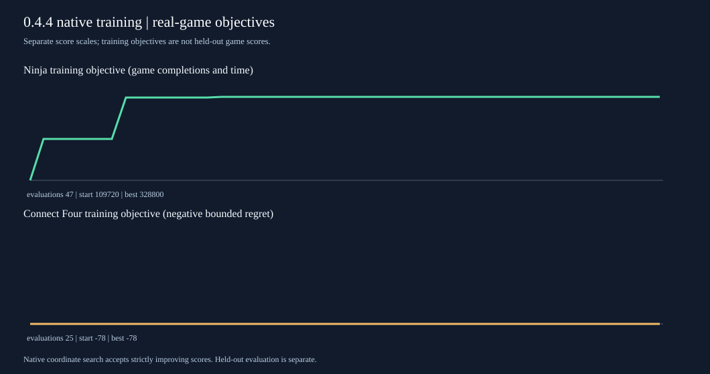
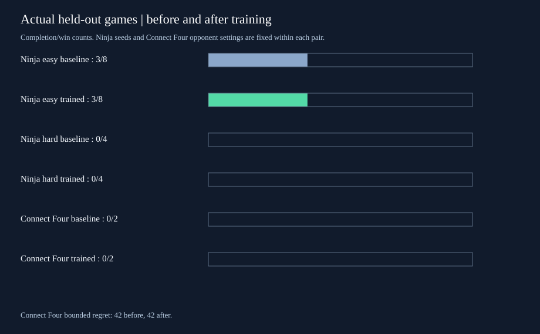

# NeuroMantle 0.4.4: real training and held-out play

The trainer in `training/optimizer.c` searches bounded integer vectors through a callback.
It accepts a candidate only on a strictly greater integer objective, uses a fixed
coordinate/direction/step sequence, records every evaluation, and has an exact
evaluation budget. The C implementation also fits deterministic 1024-bit
majority prototypes and queries them by Hamming distance. This is a reusable
finite-parameter training interface, not a claim to train arbitrary neural
architectures or to perform gradient descent.

## Ninja (original upstream Procgen engine)

Eight selected SNN synaptic weights were evaluated on easy training levels
201–206. Accepted checkpoints were evaluated separately on validation levels
301–304. The checkpoint with the best validation score was chosen before
evaluating easy levels 41–48 and hard levels 101–104. Every objective call
stepped the real game and persistent C network. The player at test time sees
only current/previous RGB observations; game rewards are training feedback.

| Evaluation | Fixed baseline | Trained checkpoint |
| --- | ---: | ---: |
| Easy level completions | 3/8 | 3/8 |
| Hard level completions | 0/4 | 0/4 |
| Easy game frames before termination | 305 | 353 |
| Hard game frames before termination | 470 | 481 |

Native search evaluated 47 real-game candidates. Its
training objective moved from 109720 at the baseline to
328800 at the best training checkpoint. Validation
selected a different checkpoint whose training objective was
219240; the held-out completion counts did not improve.
Frame totals are not a progress or survival metric. The detailed accepted
checkpoints, integer weights, seed lists and exact score trace are in
`ninja/weights.json`. Separate baseline/trained receipts, graphs and actual
game images are in `ninja/easy` and `ninja/hard`.

## Connect Four

The same native optimizer varied six sensory synaptic strengths. Its objective
was negative bounded-search regret on 28 valid board
positions from legal games on seeds 601–606. A C bridge evaluated each candidate
with the original `nm_step`, and fresh normal network receipts cross-check
the same decisions. The held-out match uses the existing two-game, depth-two
opponent and seed 41; no oracle score is exposed to the deployed SNN.

| Held-out match | Fixed baseline | Trained checkpoint |
| --- | ---: | ---: |
| Wins | 0/2 | 0/2 |
| Bounded regret across SNN moves | 42 | 42 |
| SNN moves | 13 | 13 |

The initial six-weight model already attained the best objective seen by this
local bounded search (-78). The selected checkpoint
therefore retained the initial weights. That is a completed training result,
not an improvement claim. Full trained network receipts for every played SNN
turn are in `connect4/trained_match.json`; `connect4/decisions.svg` plots the
observed decision sequence.

These small samples and hand-designed features do not establish general
Procgen performance, an Elo rating, or biological learning. The initial
Connect Four receipt and all 0.4.3 game evidence remain separately present.
