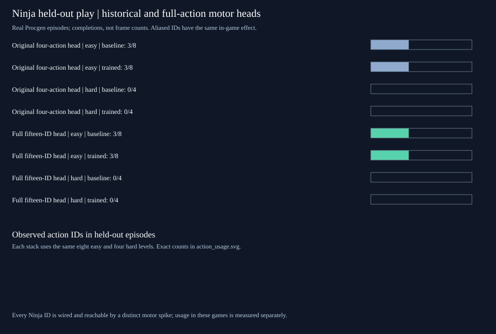
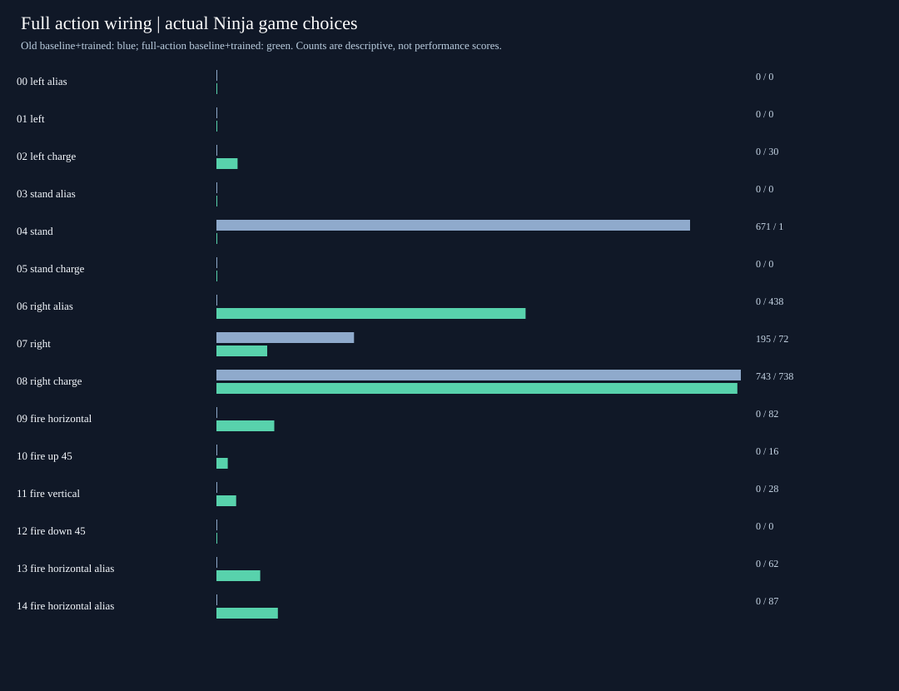

# Full action control, actual game outcomes

The original 0.4.3/0.4.4 game source, receipts, training traces and graphs remain in their original folders.
The new C motor layer maps fifteen independent sensory channels to fifteen Procgen Ninja action IDs.
Each ID is reachable through `nm_step`; gameplay proposes candidates from current and previous rendered RGB images.
Procgen aliases some IDs internally, so fifteen IDs do not mean fifteen distinct Ninja maneuvers.
Connect Four already has all seven column outputs; the new test exercises each through the receipted network.

| Controller | Easy baseline | Easy trained | Hard baseline | Hard trained |
| --- | ---: | ---: | ---: | ---: |
| Original four-action head | 3/8 | 3/8 | 0/4 | 0/4 |
| Full fifteen-ID head | 3/8 | 3/8 | 0/4 | 0/4 |

All cells use easy seeds 41–48 or hard seeds 101–104, up to 400 frames.
The newer baseline and trainer use different motor logic from the original.
Both within-version before/after pairs are valid; the cross-version comparison measures a controller change as well.

| Ninja action ID | Engine effect | Original observed | Full head observed |
| ---: | --- | ---: | ---: |
| 0 | left alias | 0 | 0 |
| 1 | left | 0 | 0 |
| 2 | left charge | 0 | 30 |
| 3 | stand alias | 0 | 0 |
| 4 | stand | 671 | 1 |
| 5 | stand charge | 0 | 0 |
| 6 | right alias | 0 | 438 |
| 7 | right | 195 | 72 |
| 8 | right charge | 743 | 738 |
| 9 | fire horizontal | 0 | 82 |
| 10 | fire up 45 | 0 | 16 |
| 11 | fire vertical | 0 | 28 |
| 12 | fire down 45 | 0 | 0 |
| 13 | fire horizontal alias | 0 | 62 |
| 14 | fire horizontal alias | 0 | 87 |

Full-action native search evaluated 91 real-game candidates.
Baseline training objective: 328990; best seen: 329180.
The selected weights and validation decisions are in `ninja/weights.json`; separate actual RGB frames, game receipts,
network state hashes, and independently reproducible SVGs are in `ninja/easy` and `ninja/hard`.
No held-out completion gain is claimed where the numbers are equal.

